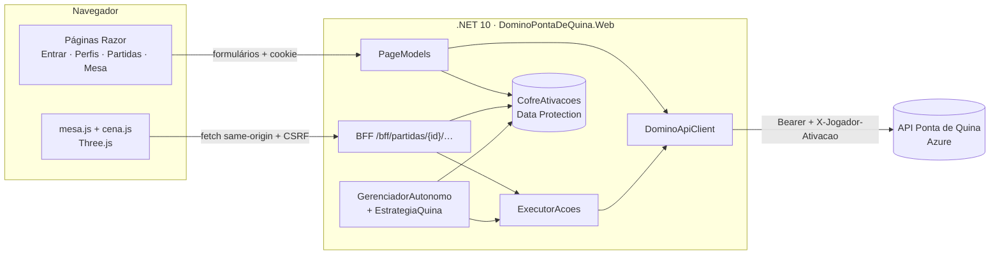
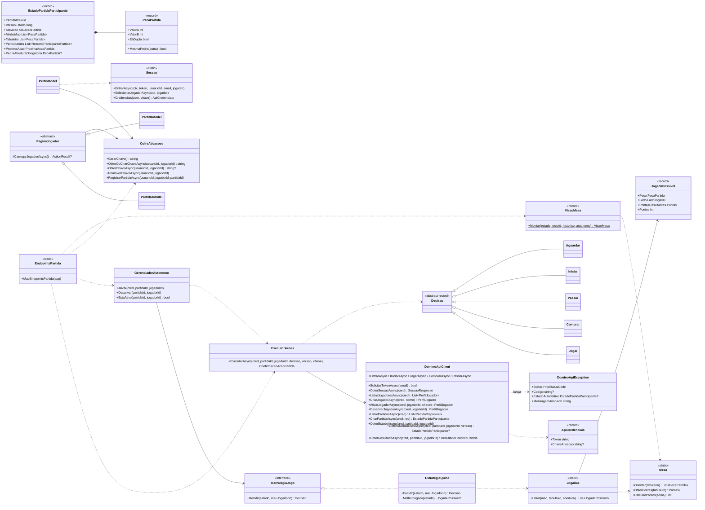

<p align="center">
  
</p>

<h1 align="center">Dominó Ponta de Quina</h1>

<p align="center">
  Cliente web em .NET para jogar Dominó Ponta de Quina pela API oficial — mesa 3D, jogador autônomo e estado sempre confirmado pelo servidor
</p>

<p align="center">
  
  
  
  
  
  
</p>

---

## Sumário

- [Visão geral](#visão-geral)
- [Regras do jogo](#regras-do-jogo)
- [Como executar](#como-executar)
- [Configuração](#configuração)
- [Como jogar](#como-jogar)
- [Temas](#temas)
- [Telas suportadas](#telas-suportadas)
- [Arquitetura](#arquitetura)
- [Diagrama de classes](#diagrama-de-classes)
- [Jogador autônomo](#jogador-autônomo)
- [Integração com a API](#integração-com-a-api)
- [Segurança](#segurança)
- [Testes automatizados](#testes-automatizados)
- [Estrutura de pastas](#estrutura-de-pastas)
- [Convenções do projeto](#convenções-do-projeto)

## Visão geral

Trabalho do **Checkpoint 6 (FIAP)**: um cliente próprio que permite a uma pessoa entrar e jogar uma partida completa
de dominó **Ponta de Quina** contra outro cliente, usando a [API oficial](https://domino-quina-api-b1-pf2261.azurewebsites.net/swagger).

O cliente:

- solicita acesso por e-mail FIAP, autentica com o token recebido, cria/escolhe um **jogador-perfil** e o ativa neste cliente;
- cria ou ingressa em partidas, mostra a **mesa em 3D** (pedras, pontas, placar, turno, cava e relógio) e envia somente as ações permitidas;
- acompanha o estado até o resultado e **explica as rejeições** sem fingir que uma ação recusada deu certo;
- oferece um **jogador autônomo** que joga sozinho no servidor, mesmo com a aba fechada.

A API é a autoridade: ela distribui as pedras, decide quem abre, valida jogadas, compras e passes, calcula a pontuação e o vencedor.
O cliente nunca altera a tela de forma otimista — ele só desenha estados confirmados.

## Regras do jogo

| Situação | Regra |
| --- | --- |
| Jogadores | 2 (partidas individuais na API) |
| Distribuição | 28 pedras, 7 por jogador; o restante forma a **cava** |
| Abertura | Começa quem tem a maior dupla; sem duplas, a API indica a maior pedra. O estado informa a **pedra obrigatória** |
| Jogada | Escolha uma pedra da mão e a ponta: `0 = esquerda`, `1 = direita` |
| Sem encaixe | Compre **uma** pedra. Se ela não encaixar, a vez passa. Passar direto só é permitido sem cava e sem pedra compatível |
| Pontuação | Após cada jogada soma-se as duas pontas; se a soma for múltipla de 5, o autor ganha `soma ÷ 5` pontos |
| Fim da rodada | Alguém esvazia a mão ou o tabuleiro trava (a API aplica a regra das pedras restantes) |
| Fim da partida | Quando alguém alcança ou ultrapassa a pontuação alvo (50, 100 ou 150) |

| Soma das pontas | 5 | 10 | 15 | 20 | 25 | 30 |
| --- | --- | --- | --- | --- | --- | --- |
| Pontos | 1 | 2 | 3 | 4 | 5 | 6 |

> **Regra futura (desconto por demora):** a mesa mostra um relógio do seu turno — verde até 10 s, amarelo até 30 s e vermelho
> depois disso — para ajudar a responder rápido quando a API passar a descontar pontos por demora.

## Como executar

Pré-requisito: **Docker** com Docker Compose. Nada é instalado no sistema operacional.

```bash
cp .env.example .env            # opcional: ajuste a URL da API
export UID GID=$(id -g)         # os containers rodam com o seu usuário
docker compose up -d web        # http://localhost:8080 com hot reload (dotnet watch)
docker compose logs -f web      # acompanhar logs
```

Rodar os testes:

```bash
docker compose --profile test run --rm test
```

Imagem de produção (multi-stage: restaura, **executa os testes**, publica e roda como usuário sem privilégios):

```bash
docker build --network host --target final -t domino-ponta-de-quina .
docker run -p 8080:8080 -e ASPNETCORE_ENVIRONMENT=Production -v domino-dados:/app/data domino-ponta-de-quina
```

> **Produção exige HTTPS na frente do app.** A imagem escuta HTTP na porta 8080 e espera um proxy reverso com TLS
> (Nginx, Traefik, Azure App Service…) que envie `X-Forwarded-Proto: https`. Ela já vem com
> `ASPNETCORE_FORWARDEDHEADERS_ENABLED=true`, então **exponha a porta 8080 somente para o proxy** — nunca diretamente
> para a internet — e acesse sempre por `https://`. Acesso direto por `http://` em produção é recusado, porque os cookies são `Secure`.
>
> Os containers de desenvolvimento usam `network_mode: host`. Assim o app fica em `localhost:8080` e alcança a API externa
> mesmo em máquinas onde a rede bridge do Docker não tem saída para a internet.

## Configuração

Toda configuração vem de variáveis de ambiente (`.env` em desenvolvimento, *secrets* em produção). Veja `.env.example`.

| Variável | Padrão | Descrição |
| --- | --- | --- |
| `DominoApi__BaseUrl` | `https://domino-quina-api-b1-pf2261.azurewebsites.net` | Endereço base da API do jogo |
| `DominoApi__TimeoutSegundos` | `15` | Tempo limite de cada chamada à API |
| `Armazenamento__Diretorio` | `data` | Onde ficam as chaves de ativação cifradas e as chaves do Data Protection. **Monte um volume persistente** |
| `ASPNETCORE_ENVIRONMENT` | `Development` (compose) | `Production` liga HSTS, redirecionamento HTTPS e cookies `Secure` |

> ⚠️ A pasta de dados guarda as chaves de ativação dos perfis. A API **não expira** ativações: se a chave for perdida,
> o perfil fica preso a este cliente até ser liberado. Faça backup do volume ou libere os perfis antes de descartá-lo.

## Como jogar

1. **Entrar** – informe o e-mail `@fiap.com.br` e clique em *Enviar token por e-mail*. Cole o token recebido e entre.
   O token é reutilizável até ser revogado (*Perfis → Revogar token e sair*).
2. **Perfis** – crie um jogador e clique em *Usar este perfil*. O cliente gera uma chave de 32 bytes, guarda-a cifrada e ativa o perfil.
   Para usar o perfil em outro cliente, clique em *Liberar*.
3. **Partidas** – crie uma mesa (alvo 50/100/150) ou entre em uma mesa aguardando adversário. Também é possível abrir uma mesa pelo código.
4. **Mesa** – quando houver dois participantes, clique em *Iniciar partida*. Na sua vez, as pedras que encaixam brilham em rosa:
   clique em uma para jogar. Se ela couber nas duas pontas, escolha o lado (os fantasmas na mesa e os botões mostram os pontos).
   *Comprar* e *Passar* só ficam habilitados quando a API indica essa ação.
5. **Jogador autônomo** – ligue o interruptor para que o servidor jogue por você. Desligue para retomar o controle.

## Temas

O seletor **Tema** no cabeçalho troca o visual na hora, inclusive com a partida em andamento. A escolha fica salva em um
cookie de preferência (`domino.tema`, não sensível), validado no servidor, então a página já abre no tema certo.

| Tema | Visual |
| --- | --- |
| **Mesa de Poker** (padrão) | Feltro roxo com borda rosa, aro de madeira, pedras com contorno estilo *toon* e interface rosa/dourada |
| **Mesa de Bar** | Boteco brasileiro: duas mesas plásticas amarelas juntadas, chão de calçadão de Copacabana, garrafas de 600 ml, copos americanos com cerveja, prato de bolinhos, tampinhas, bandeirinhas de festa junina e interface verde e amarela |

As marcas exibidas (“Bar do Quina”, “Cerveja Quina”) são fictícias. Cada tema fica em `wwwroot/js/temas.js`
(ambiente 3D: luzes, mesa, piso, objetos e verso das pedras) e em um bloco `html[data-tema="…"]` de variáveis em `site.css`.
Para criar um tema novo, adicione uma entrada em `TEMAS` (JS), em `Ui/Temas.cs` e, se quiser cores próprias, um bloco de variáveis no CSS.

## Telas suportadas

Computadores e **tablets** (retrato e paisagem). Em telas com menos de 700 px de largura ou 520 px de altura — celulares
em qualquer orientação — o jogo mostra o aviso **“Sua tela é muito pequena”**, porque a mesa 3D não cabe de forma jogável.

## Arquitetura

O projeto é um único app **ASP.NET Core** que faz duas coisas: renderiza as telas no servidor com **Razor Pages**
(o equivalente .NET ao Jinja) e funciona como **gateway** (*Backend for Frontend*) para a API do jogo.
O navegador nunca fala com a API diretamente: token e chave de ativação ficam no servidor.



Ciclo de uma jogada:

```mermaid
sequenceDiagram
    participant U as Jogador (navegador)
    participant B as BFF (.NET)
    participant A as API
    U->>B: POST /acoes {tipo, versao, chaveIdempotencia}
    B->>A: POST /api/partidas/{id}/jogar (versaoEsperada, chave)
    alt aceita
        A-->>B: 200 ConfirmacaoAcaoPartida (estado confirmado)
        B-->>U: VisaoMesa → tela atualizada
    else conflito de versão
        A-->>B: 409 + estadoAutoritativo
        B-->>U: mensagem + VisaoMesa autoritativa
    else regra violada
        A-->>B: 422 ENCAIXE_INVALIDO…
        B-->>U: mensagem; a mesa não muda
    end
    loop a cada 1,5 s
        U->>B: GET /estado?versao=n
        B->>A: GET /atualizacoes?versaoConhecida=n
        A-->>B: 204 (nada mudou) ou 200 (novo estado)
    end
```

## Diagrama de classes



## Jogador autônomo

`GerenciadorAutonomo` mantém um laço por par *(partida, perfil)* rodando no servidor:

1. consulta `/atualizacoes` com a última versão conhecida (204 = nada mudou);
2. pede uma `Decisao` à `EstrategiaQuina`;
3. executa a ação com uma **chave de idempotência nova por intenção** — falhas de rede repetem a **mesma** chave;
4. aplica o estado confirmado; em `409` usa o `estadoAutoritativo`; em `401/403/404` encerra; termina quando a partida acaba.

A estratégia é gulosa com proteção defensiva:

```
valor(jogada) = pontos_agora − 0,5 × melhor_resposta_do_adversário + 0,02 × soma_da_pedra + 0,1 × (é dupla)
```

- **pontos_agora**: `soma das pontas ÷ 5` quando múltipla de 5;
- **melhor_resposta_do_adversário**: o máximo que qualquer pedra ainda desconhecida (fora da mão e da mesa) faria nas novas pontas;
- desempate por pedras pesadas (menos pontos na mão se o jogo travar) e duplas (mais difíceis de encaixar depois).

O mesmo `ExecutorAcoes` é usado pelas ações humanas, então o bot e a pessoa seguem exatamente o mesmo protocolo.

## Integração com a API

| Etapa | Endpoint | Onde |
| --- | --- | --- |
| Solicitar token | `POST /api/identidade/token` | `EntrarModel.OnPostSolicitarAsync` |
| Validar token | `GET /api/identidade/sessao` | `EntrarModel.OnPostAutenticarAsync` |
| Revogar token | `POST /api/identidade/tokens/revogacao` | `SairModel.OnPostRevogarAsync` |
| Perfis | `GET/POST /api/jogadores` | `PerfisModel` |
| Ativar / liberar perfil | `POST …/ativar-cliente` · `DELETE …/desativar-cliente` | `PerfisModel` + `CofreAtivacoes` |
| Listar / criar / entrar | `GET/POST /api/partidas` · `POST …/entrar` | `PartidasModel` |
| Iniciar, jogar, comprar, passar | `POST …/iniciar` `…/jogar` `…/comprar` `…/passar` | `ExecutorAcoes` |
| Estado e atualizações | `GET /api/partidas/{id}` · `GET …/atualizacoes` | `PartidaModel`, `EndpointsPartida`, `GerenciadorAutonomo` |
| Histórico / resultado | `GET …/resultado` | `VisaoMesa` (histórico e posição da pedra de abertura) |

Tratamento de respostas:

| HTTP | Comportamento do cliente |
| --- | --- |
| 401 | Sessão encerrada e redirecionamento para *Entrar* |
| 403 | Mensagem de permissão; nada muda |
| 409 | Aplica `estadoAutoritativo` e informa o conflito (ou orienta liberar o perfil em `JOGADOR_JA_ATIVO`) |
| 422 | Mostra o motivo (`ENCAIXE_INVALIDO`, `FORA_DO_TURNO`, …); a partida não avançou |
| 429 | Informa o tempo de espera do limite de solicitações de token |
| 5xx / rede | Repete com a mesma chave de idempotência; se falhar, avisa que a ação **não** foi confirmada |

Premissa documentada: o contrato publica `ProximaAcaoPartida` apenas como números (`0…5`). O cliente segue a ordem apresentada no
material da disciplina — `0 Aguardar`, `1 JogarAbertura`, `2 Jogar`, `3 Comprar`, `4 Passar`, `5 Encerrar` (`Api/Contracts.cs`).

## Segurança

- **Credenciais só no servidor**: o token vive dentro do cookie de autenticação cifrado (`HttpOnly`, `SameSite=Strict`, `Secure` em produção);
  nenhuma página ou script recebe o token ou a chave de ativação.
- **Chaves de ativação** geradas com `RandomNumberGenerator` (32 bytes → 64 hex), guardadas cifradas com ASP.NET Core Data Protection,
  isoladas por usuário e persistidas com escrita atômica.
- **CSRF**: formulários Razor validam antiforgery; os endpoints JSON exigem o cabeçalho `X-CSRF-TOKEN`.
- **CSP restritiva** (`script-src 'self'`, sem scripts inline, sem CDNs — Three.js e fontes são servidos localmente),
  `X-Frame-Options: DENY`, `nosniff`, `Referrer-Policy: no-referrer`; HSTS e HTTPS em produção.
- **Validação de entrada**: e-mail restrito a `@fiap.com.br`, nome 1–150, pontuação alvo em lista fechada, valores de pedra 0–6, rotas com `Guid`.
- **Rate limiting** na tela de entrada (30 req / 10 min por IP), complementando o limite da própria API.
- Imagem de produção roda como usuário `app` (não root).
- **Pendente para produção real:** as chaves do Data Protection ficam no mesmo volume, sem cifragem própria
  (o ASP.NET avisa *No XML encryptor configured*). Quem obtiver o volume inteiro consegue decifrar as chaves de ativação.
  Em um ambiente de produção, proteja as chaves com certificado ou cofre (`ProtectKeysWithCertificate`, Azure Key Vault).
  Para o escopo do trabalho, o volume é tratado como segredo.

## Testes automatizados

`tests/DominoPontaDeQuina.Tests` (xUnit):

| Suíte | O que cobre |
| --- | --- |
| `MesaTests` | Pontuação por múltiplos de 5, orientação da cadeia e pontas |
| `JogadasTests` | Abertura obrigatória, encaixe nas duas pontas, pontos resultantes |
| `EstrategiaQuinaTests` | Decisões do jogador autônomo (jogar, comprar, passar, iniciar, aguardar) e defesa contra quina do adversário |
| `DominoApiClientTests` | Cabeçalhos `Bearer`/`X-Jogador-Ativacao`, formato do corpo, 204, 409 com estado autoritativo, 422, 400 e 429 |
| `ExecutorAcoesTests` | Repetição com a mesma chave de idempotência e roteamento por ação |
| `CofreAtivacoesTests` | Formato da chave, persistência entre reinícios, cifragem em disco e isolamento por usuário |
| `VisaoMesaTests` | Visão filtrada do jogador, cálculo da cava, pedra de abertura e validação de e-mail |
| `IntegracaoHttpTests` | Autenticação obrigatória, 401 nos endpoints JSON, cabeçalhos de segurança e antiforgery |

## Estrutura de pastas

```
.
├── compose.yaml                     # dev (hot reload) e perfil de testes
├── Dockerfile                       # estágios dev / build (com testes) / final
├── src/DominoPontaDeQuina.Web
│   ├── Api/                         # contratos e cliente HTTP tipado da API
│   ├── Game/                        # regras locais, estratégia, executor, jogador autônomo, VisaoMesa
│   ├── Security/                    # sessão (cookie) e cofre de chaves de ativação
│   ├── Bff/                         # endpoints JSON usados pela mesa
│   ├── Pages/                       # Razor Pages (Entrar, Perfis, Partidas, Partida, Sair)
│   ├── Ui/                          # temas disponíveis
│   └── wwwroot/                     # css, fontes, logo, Three.js e scripts (cena.js, mesa.js, temas.js, tema.js)
└── tests/DominoPontaDeQuina.Tests   # testes xUnit
```

## Convenções do projeto

- **Git flow**: `master` (entregas), `develop` (integração), `feat/*`, `bugfix/*`, `release/vX.Y.Z`, `hotfix/*`.
- **Conventional Commits** (`feat:`, `fix:`, `test:`, `docs:`, `build:`, `style:` …).
- Código e domínio em português, alinhados ao vocabulário da API (`Partida`, `Pedra`, `Ponta`, `Cava`).
- Desenvolvimento sempre em Docker; nada é instalado na máquina.
